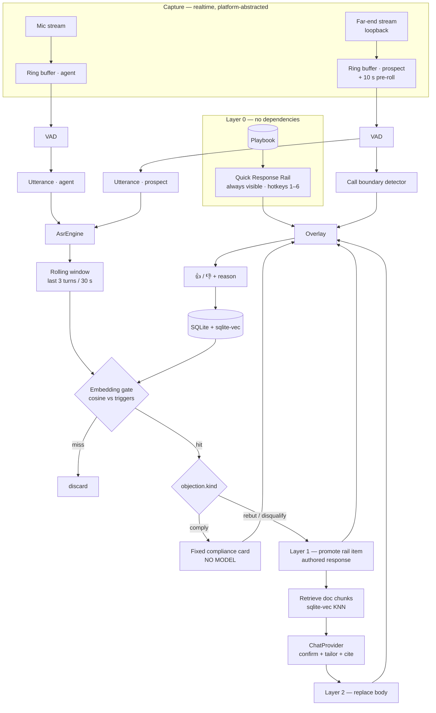

# 02 — Architecture

## 1. Shaping decisions

Seven choices that everything else follows from.

**1. The rail is the product; the pipeline is an enhancement.**
The Quick Response Rail renders from the playbook alone. No audio, no ASR, no embeddings, no network. Every downstream component *improves* the rail — promoting an item, expanding it, rewriting its body — but none is required for the app to be useful. This is the difference between a shippable v1 and a demo that falls over on a bad WiFi day.

**2. Two audio streams, never mixed.**
Mic is the agent. Loopback is the prospect. Attribution comes from *which buffer the samples arrived in*. No diarization model, no speaker embeddings, and no failure mode where the app coaches the agent on their own words. Detection runs on the far-end stream only, halving the work.

**3. Cheap local gate, then one LLM call.**
Embed each far-end utterance locally (BGE-small, single-digit ms on CPU) and cosine-match against the objection triggers. Only a gate hit spends an LLM call, and that call does confirmation *and* tailoring together. The gate rejects >95% of speech for free, which is what makes local-only mode pleasant rather than a compromise.

**4. Platform abstraction on day one, Windows implementation only.**
Not because macOS is hard, but because its capture model differs in three ways that a Windows-only design silently assumes away. See §3.

**5. Calls are detected from audio, not from the dialer.**
No API integration in v1. The far-end stream tells you everything: sustained voice means a live call, extended silence means it ended. Ricochet360's ~1-second lead stacking means there is almost no gap between calls, so this needs to be a real component rather than an afterthought. See §5.

**6. `comply` objections bypass the model entirely.**
An objection carries a `kind`. `rebut` objections flow through the full pipeline. `comply` objections — DNC requests above all — render a fixed, authored, unmodifiable card and never reach an LLM. Enforced at the type level, not by prompt instruction.

**7. The replay harness comes first.**
A headless CLI takes recorded audio plus a playbook and emits the same detections the GUI would. Built before the GUI, it makes the pipeline testable in CI without audio hardware, makes the eval loop possible, and makes the repo demoable in ninety seconds.

---

## 2. System diagram



---

## 3. Platform abstraction

Windows ships. macOS is designed for and stubbed. The abstraction exists now because macOS differs in three ways that would otherwise be baked in wrongly.

**Start is async and fallible.** WASAPI loopback simply opens. macOS requires TCC permission, can be denied outright, and can have permission revoked mid-session. A synchronous infallible `start()` would need rewriting through every caller.

**The output is a callback, not a device handle.** Core Audio Process Taps require constructing a private aggregate device with the tap attached as a sub-tap. Notably, `AVAudioEngine` cannot be retargeted onto a tap-backed aggregate device — setting the current device returns `noErr` while the engine quietly keeps reading the default input, so you must drive `AudioDeviceCreateIOProcIDWithBlock` on the aggregate directly. The abstraction must therefore be "hand me frames via callback," never "give me a device to read."

**Permission tiers differ, and the narrow one is worth targeting.** Core Audio Taps (macOS 14.4+) requires only "System Audio Recording." ScreenCaptureKit triggers the considerably more alarming "Screen & System Audio Recording" prompt. For a tool an insurance agency has to be talked into installing, that prompt difference is an adoption issue. Design for taps and accept the OS version floor.

```rust
// crates/audio/src/lib.rs

#[async_trait]
pub trait CaptureBackend: Send + Sync {
    /// Enumerate what this platform can capture.
    async fn enumerate(&self) -> Result<Vec<CaptureSource>, CaptureError>;

    /// Begin capture. Frames arrive via `sink`, called on a realtime thread.
    /// Fallible and async: macOS may prompt, may be denied, may be revoked.
    async fn start(
        &self,
        source: CaptureSource,
        sink: Arc<dyn FrameSink>,
    ) -> Result<CaptureHandle, CaptureError>;

    fn permission_state(&self) -> PermissionState;
    async fn request_permission(&self) -> Result<PermissionState, CaptureError>;
}

pub enum CaptureSource {
    Microphone { device_id: String },
    SystemMix,
    Process { pid: u32, include_children: bool },
}

pub enum CaptureError {
    PermissionDenied,
    PermissionRevoked,      // can occur mid-session on macOS
    SourceUnavailable,
    UnsupportedOnPlatform,
    Backend(String),
}

/// Implemented downstream. MUST be realtime-safe:
/// no allocation, no locks, no I/O, no logging.
pub trait FrameSink: Send + Sync {
    fn on_frames(&self, pcm: &[f32], sample_rate: u32, channels: u16);
}
```

| Platform | Backend | Status |
|---|---|---|
| Windows 10 2004+ | `WasapiBackend` | v1 |
| macOS 14.4+ | `CoreAudioTapBackend` | stub, `UnsupportedOnPlatform` |
| Linux | `PipewireBackend` | not planned |

`crates/audio` is the only crate permitted to contain `#[cfg(windows)]`.

---

## 4. Capture (`crates/audio`)

### Windows implementation

Use the [`wasapi`](https://docs.rs/wasapi) crate, not `cpal`. `cpal`'s loopback support has been an open issue since 2018, `AUDCLNT_STREAMFLAGS_LOOPBACK` interacts badly with its event-driven callback, and it cannot do per-process capture at all. The `wasapi` crate wraps Win32 directly and exposes `PROCESS_LOOPBACK_MODE`.

Two far-end modes:

| Mode | Default | Mechanism | Trade-off |
|---|---|---|---|
| System mix | ✅ | Default render endpoint + `AUDCLNT_STREAMFLAGS_LOOPBACK` | Captures Slack pings, Spotify, everything |
| Per-process | | `new_application_loopback_client(pid, include_tree)` | Cleaner — but see below |

**System mix is the default specifically because of browser dialers.** Chrome renders audio in a child process, so per-process capture requires `include_tree = true`, which then captures every tab — YouTube, Spotify Web, notification sounds. For Ricochet360 users this is strictly worse than the system mix. Per-process stays available for agents on a native softphone.

Mitigate the system-mix downside with a **global mute hotkey** (default `Ctrl+Shift+M`) that suspends capture without tearing down the stream, plus a visible capture indicator.

Constraints to design around:

- Loopback works only in **shared mode**; exclusive-mode streams are uncapturable
- Event-driven loopback works on Win10 1703+; the legacy render-stream workaround is unnecessary
- Per-process mode: `get_device_period` is nonfunctional and the period passed to `initialize_client` is ignored
- The callback converts to f32 and pushes to an SPSC ring buffer. Nothing else, ever.

Resample 44.1k/48k → 16 kHz mono with `rubato` on the *consumer* side.

### Pre-roll buffer

The far-end ring buffer keeps a rolling **10-second pre-roll**. When a call boundary is detected, the detector reaches backwards into it and transcribes from before the detection point.

This exists because Ricochet360 connects a lead in roughly a second and stacks the next one immediately. By the time voice activity confirms a live call, the prospect has already said "hello" and possibly the first objection. Without pre-roll, the highest-value fifteen seconds of every call are missed. This is the single most important accommodation to the target environment.

---

## 5. Call boundary detection (`crates/detect`)

A dialer session is one continuous audio stream containing dozens of calls with near-zero gaps. The `call` is the unit that matters — dedupe windows, card lifetime, feedback attribution, and session history all key off it.

State machine on the far-end stream:

```
                  ┌──────────┐
     ┌───────────►│   IDLE   │
     │            └────┬─────┘
     │       far-end voice ≥ 1.2 s
     │                 ▼
     │            ┌──────────┐
     │            │  RINGING │  ← ringback / IVR / voicemail greeting
     │            └────┬─────┘
     │      bidirectional turn-taking observed
     │      (agent speaks AND far-end speaks within 6 s)
     │                 ▼
     │            ┌──────────┐
     │            │  ACTIVE  │  ← emit CallStarted, drain pre-roll
     │            └────┬─────┘
     │      far-end silence ≥ 3.5 s AND agent silence ≥ 3.5 s
     │                 ▼
     │            ┌──────────┐
     └────────────┤  ENDING  │  → emit CallEnded after 2 s confirmation
                  └──────────┘
```

Notes that matter in practice:

- **RINGING exists to suppress voicemail.** A voicemail greeting is sustained far-end voice with no turn-taking. Requiring bidirectional exchange before ACTIVE prevents the app firing objection cards at an answering machine — which would otherwise happen on the majority of dials.
- **A new call can begin ~1 s after the last ends.** ENDING → IDLE → RINGING must complete inside that. Keep the confirmation window at 2 s and accept occasional merged calls rather than raising it.
- **Emit `CallStarted` on entering ACTIVE, then immediately drain the pre-roll** through ASR so the opening exchange is in the transcript window.
- Detection is suppressed entirely in IDLE and RINGING.
- Expose thresholds in advanced settings. Different dialers behave differently and this will need field tuning.

---

## 6. Segmentation and ASR

Silero VAD via `ort`, per stream. Emit a finalized utterance when:

- ≥ 300 ms accumulated speech, **and**
- ≥ 500 ms trailing silence (primary latency knob), **or**
- 12 s hard cap

Emit interim partials every ~400 ms for the live transcript pane, but **never feed partials into detection** — they cause duplicate fires on half-formed sentences.

### ASR engines (`crates/asr`)

```rust
pub trait AsrEngine: Send {
    fn transcribe(&mut self, pcm: &[f32], opts: &TranscribeOptions) -> Result<Transcript>;
    fn capabilities(&self) -> AsrCapabilities;
}
```

Wrap [`transcribe-rs`](https://lib.rs/crates/transcribe-rs), which already multiplexes Parakeet, Moonshine, Whisper, Canary, and SenseVoice behind one interface.

**Default: Moonshine v2 tiny**, bundled so first run needs no download. Its streaming encoder is built for latency-critical use and the smallest model is around 27 MB. **Upgrade option: Parakeet TDT**, which ships as INT8 ONNX in the 631–680 MB range and runs on any recent CPU via sherpa-onnx — a native binary with no Python and no PyTorch, which matters enormously for a Windows installer.

Avoid Whisper as a default: it hallucinates confidently on silence, which in a dialer context means fabricated objections between calls.

Optional `RemoteEngine` (Deepgram / AssemblyAI streaming) for agents who want maximum accuracy and accept the network hop. Disabled in local-only mode.

---

## 7. Detection (`crates/detect`)

### Stage 1 — the gate

Per finalized **far-end** utterance, while state is ACTIVE:

1. Build the window: last 3 far-end turns or 30 s, whichever is shorter. Objections build across turns — "Hmm." / "Yeah, I don't know." / "We're already covered." Single-utterance matching misses these constantly.
2. Embed with `fastembed` (BGE-small-en-v1.5, 384-dim, ONNX, synchronous, no Tokio).
3. Cosine against trigger vectors. A playbook is tens to low hundreds of entries — brute-force SIMD beats any index and is simpler than both.
4. `max_similarity < threshold` → stop, no LLM call. Default 0.62, per-objection, learned from feedback.
5. Dedupe: suppress the same `objection_id` within 45 s **of the same call**. Reset on `CallStarted`.

### Stage 2 — branch on kind

```rust
match objection.kind {
    ObjectionKind::Comply => {
        // Fixed authored card. No retrieval, no LLM, no tailoring.
        // See docs/06-COMPLIANCE.md §3.
        emit(Card::compliance(objection));
    }
    ObjectionKind::Rebut | ObjectionKind::Disqualify => {
        emit(Card::promoted(objection));          // Layer 1, immediate
        spawn(refine(objection, window, docs));   // Layer 2, best-effort
    }
}
```

### Stage 3 — refinement

1. KNN the window against `doc_chunks` via `sqlite-vec` — top 4, filtered to the objection's `doc_refs` when set.
2. One LLM call. Structured JSON:

```json
{
  "is_objection": true,
  "objection_id": "obj_no_form",
  "confidence": 0.86,
  "headline": "Denies submitting a form — likely an aged lead",
  "response": "…tailored to their actual words…",
  "next_question": "Do you remember comparing rates online around March?",
  "citations": ["doc_lead_sources#chunk_3"]
}
```

3. `is_objection: false` → **demote the rail item back to neutral**. The gate is deliberately loose; the model is the precision layer. A card that expands and collapses in 1.5 s costs far less than a wrong card that persists.

One call, not two. A separate classification step doubles latency to save tokens the gate already saved.

---

## 8. LLM providers (`crates/llm`)

```rust
#[async_trait]
pub trait ChatProvider: Send + Sync {
    async fn complete(&self, req: ChatRequest) -> Result<ChatResponse, LlmError>;
    fn supports_prompt_cache(&self) -> bool;
    fn id(&self) -> ProviderId;
}
```

| Implementation | Covers |
|---|---|
| `OpenAiCompatProvider` | OpenRouter, OpenAI, Ollama, LM Studio, llama.cpp server, vLLM, Groq, Together |
| `AnthropicProvider` | Anthropic native — for prompt caching and proper system blocks |

**OpenRouter.** Base URL `https://openrouter.ai/api/v1`. Fetch `GET /api/v1/models` when settings opens and build a searchable picker showing pricing and context length inline — that catalog is the entire reason to integrate OpenRouter rather than treating it as one more OpenAI endpoint. Send `HTTP-Referer` and `X-Title`. Surface per-session cost from returned usage.

**Timeout is a hard 2500 ms.** Past that the agent has already spoken. On timeout keep the Layer 1 card and log `latency_exceeded` — that data tells the user their model is too slow for live use, which they should learn from the app rather than from a lost sale.

**Prompt caching.** The system prompt is static for a whole session: role, output schema, all objection labels, global guardrails. Mark it as a cache breakpoint on Anthropic. Across a four-hour dialing session with 40 detections this is a large cost difference and is the sole justification for a second provider implementation.

Secrets in **Windows Credential Manager** via `keyring`. Never in config files, never in playbook exports.

---

## 9. Concurrency

```
[capture callbacks ×2]   realtime — convert + push only
        │ crossbeam SPSC ring buffers (far-end retains 10 s pre-roll)
        ▼
[VAD threads ×2]         dedicated OS threads
        │ crossbeam channel
        ▼
[call boundary detector] far-end VAD + agent VAD → CallState
        │
        ▼
[ASR pool]               2 workers, bounded queue, drop-OLDEST under pressure
        │ tokio::mpsc
        ▼
[tokio runtime]          gate · retrieval · LLM · persistence
        │ Tauri events
        ▼
[UI thread]              overlay + console
```

The ring buffer is the realtime boundary and it is inviolable. Above it: lock-free, allocation-free. Below it: block freely.

Under pressure the ASR queue drops the **oldest** pending utterance. Stale coaching is worse than absent coaching.

---

## 10. Latency budget

| Stage | Target |
|---|---|
| **Rail visible (Layer 0)** | **0 ms — rendered at app start** |
| Capture → ring buffer | 10–20 ms |
| VAD endpoint | 500 ms |
| ASR (Moonshine tiny, CPU) | 150–350 ms |
| Embed + cosine gate | < 10 ms |
| **Rail item promoted (Layer 1)** | **~700–900 ms** |
| Doc retrieval | 5–15 ms |
| LLM — local 8B on GPU | 400–900 ms |
| LLM — hosted small (Haiku/Flash tier) | 600–1200 ms |
| LLM — hosted frontier | 1500–3000 ms, often too slow |
| **Body refined (Layer 2)** | **1.4–2.5 s, hard-capped** |

Surface measured p50 per model in the picker. An agent choosing a frontier model should see that it will usually miss the window.

---

## 11. Repo layout

```
├─ crates/
│  ├─ audio/       CaptureBackend trait, WasapiBackend, ring buffers, pre-roll  [only cfg(windows)]
│  ├─ asr/         AsrEngine trait, transcribe-rs + remote impls
│  ├─ detect/      VAD, segmentation, call boundaries, embedding gate, dedupe
│  ├─ playbook/    schema, YAML, import/export, document ingestion
│  ├─ llm/         ChatProvider trait, OpenAI-compat, Anthropic, OpenRouter catalog
│  ├─ store/       rusqlite + sqlite-vec, migrations, feedback
│  └─ core/        pipeline orchestration, session/call lifecycle, config
├─ apps/
│  ├─ desktop/     Tauri v2 — overlay + console (Svelte)
│  └─ replay/      headless CLI: audio + playbook → JSONL
├─ evals/
│  ├─ fixtures/    labeled call audio + expected detections
│  └─ run.rs       precision / recall / latency
└─ playbooks/
   └─ insurance-cold-call.yaml
```

Cargo workspace. Everything except `crates/audio` compiles and tests on Linux, so CI is cheap and macOS support later is one crate rather than a rewrite.

---

## 12. Risks

| Risk | Mitigation |
|---|---|
| Voicemail greetings trigger cards | RINGING state requires bidirectional turn-taking before ACTIVE |
| Back-to-back calls merge into one | 2 s confirmation window; accept occasional merges over missed starts |
| Opening objection missed | 10 s pre-roll buffer, drained on `CallStarted` |
| System mix picks up Spotify/Slack | Mute hotkey, capture indicator, per-process available |
| VoIP codec degrades ASR | Measure before adding denoise; Moonshine is fairly robust on telephony |
| Gate threshold is user-specific | Per-objection thresholds learned from feedback; calibration wizard |
| Agent reads cards verbatim, sounds robotic | Cards are bullets + one question, never prose. Content fix, not code |
| Frontier model too slow | Layer 1 makes it survivable; show measured p50 in picker |
| DNC request gets a rebuttal | `kind: comply` enforced at type level, plus required test |
